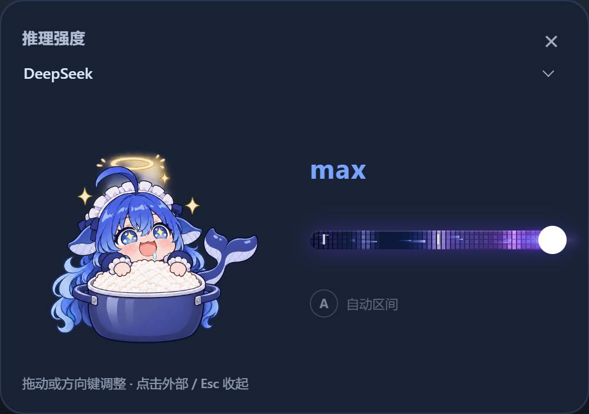
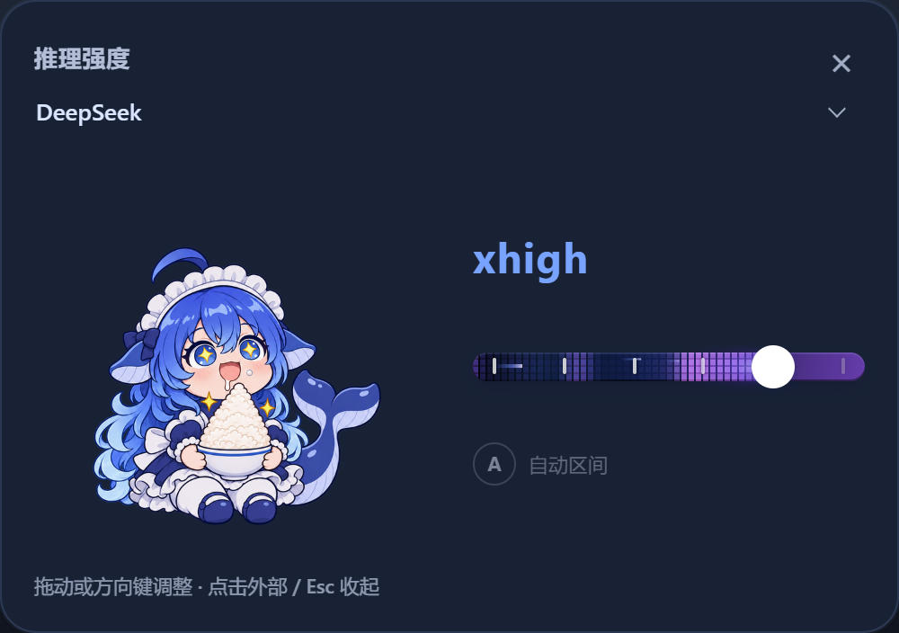

# DSH-推理等级可视化-吃白饭大肥鱼

为 [DeepSeek Harness](https://github.com/deepseek-ai/deepseek-harness) 提供一个可折叠的模型／推理等级面板：平时只显示当前档位，展开后用高清「大肥鱼」插画和滑条选择思考强度。

## 预览

下图来自使用真实插件代码的独立测试页面，模型目录为模拟数据，不包含私人聊天。弹框可以配合宿主主题使用，实际配色随主题变化。





## 功能

- **紧凑收起**：只显示当前档位与箭头，按钮位于原模型席位，靠近发送键。
- **模型选择合并**：弹框顶部按供应商分组选择模型；采用目标模型声明的默认档位。
- **档位自适应**：读取当前模型实际声明的能力。模型只有 low/high/max 就只显示三档；不会虚构 xhigh、off 或 auto。
- **高清形象**：八个状态 `minimal / low / medium / high / xhigh / max / auto / off`；224 CSS px 显示，内嵌 672×672 RGBA PNG。原始编辑母版为统一 1024×1024 画布。
- **丝滑切换**：双层图片约 180 ms 淡入淡出，支持减少动态效果。
- **实时轨道特效**：拖到 Max 立即开启完整粒子，xhigh 为精简粒子，离开则即时清空。鼠标不用松手。
- **预览与提交分离**：拖动只更新画面，松手才提交一次；取消拖动恢复原选择与动效。
- **交互完整**：方向键、Home/End、PageUp/PageDown；外部点击、Esc、关闭按钮收起；支持窄窗口。
- **错误可见**：选择失败显示原因并恢复；旧请求不覆盖新模型或会话。

未知的新档位保留真实 id/名称，并使用 medium 图片兜底，不会改变提交的档位 id。当前模型未声明的档位即使有图片也不会出现。

## 安装

目前按源码／本地插件包安装，不声称已发布到 npm。

1. 下载此仓库，或从 `releases/` 取得随仓库附带的 `.tgz`。
2. 按 [安装与卸载指南](docs/INSTALL.md) 放入 DSH profile，并添加一次 bundle。
3. 确认没有运行中的任务后，由你手动刷新或重新打开 DSH。

兼容范围由 `package.json` 声明为 DSH `>=0.2.0-rc.1 <0.3.0-0`，不代表该范围内每个版本都已实机验证。开发环境曾在 Windows 的 DSH 0.2.2-rc.1 中使用；公共源码包包含 13 项 Node 测试与 30 项独立浏览器交互测试。未来宿主更改插件接口时可能需要适配。

## 开发

使用已验证的 Node.js 24 开发环境（包要求至少 Node 22.19）：

```sh
npm ci
npm run build
npm test
npx playwright install chromium
npm run test:browser
npm run check:public
npm run pack:release
```

`npm run pack:release` 只在本地创建安装包，不上传任何内容。详细说明见 [开发指南](docs/DEVELOPMENT.md) 和 [发布检查表](docs/PUBLISHING.md)。

## 范围与隐私

可选「自动区间」及模型路由继承自上游，默认均未开启。普通手动选择直接使用宿主的共享模型目录，不额外发送推理请求。自动区间只在启用后参与后续请求；路由功能启用后会检查当前会话信息。有关本地状态、诊断样本和反馈脱敏，见 [安全与隐私说明](SECURITY.md)。

本仓库不包含用户 profile、订阅、凭据、真实对话、安装目录或私人截图。它不保证特定模型支持所有图示档位，也不附带整套主题。

## 致谢与许可

基于 [zengxiaolou/dsh-effort-dial](https://github.com/zengxiaolou/dsh-effort-dial) 的 `@zengevent/dsh-effort-dial@0.8.2`，保留原作者 MIT 许可与署名。本项目的可折叠面板、合并模型选择器、高清状态图、实时拖动预览和保护逻辑是在该基础上的修改。

代码及本项目可授权的新增内容按 [MIT](LICENSE) 提供。插画生成来源、适用说明以及第三方品牌／角色权利边界见 [素材说明](docs/ARTWORK.md) 和 [NOTICE](NOTICE.md)。本项目并非 DeepSeek 官方产品，也不代表与其存在从属或授权关系。
